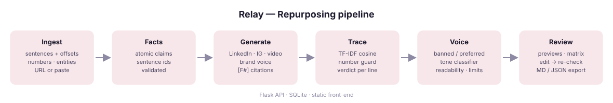
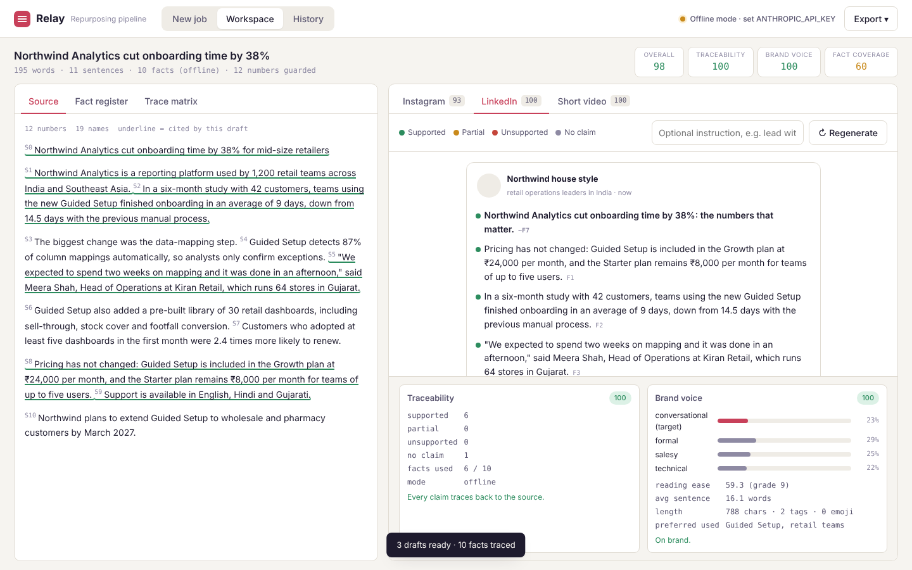

# Relay — Social Content Repurposing Pipeline

Turn an approved blog post, case study or product page into a LinkedIn post, an Instagram carousel and a short-video script. Relay preserves the source facts, enforces the brand voice, and shows line-by-line traceability from every generated sentence back to the sentence it came from.





## How it works

| Stage | Module | Technique |
|---|---|---|
| 1. Ingest | `app/ml/ingest.py` | Paste or URL (requests + BeautifulSoup); sentence segmentation with character offsets; regex extraction of numbers, money, percentages, dates and proper nouns — the "guarded" values |
| 2. Fact extraction | `app/ml/facts.py` | Claude lists atomic facts with the sentence ids they cite; ids are validated against the source. Offline: sentences with numbers/entities become facts |
| 3. Generation | `app/ml/generate.py` | One structured prompt per platform with the fact register + brand voice; the model must append `[F3]` citations to every claim; strict JSON |
| 4. Traceability | `app/ml/trace.py` | TF-IDF (word + char n-gram) embeddings of every output line vs facts and source sentences → cosine similarity; cited facts are verified independently; every number in the output must exist in the source (hard fail); verdict per line: supported / partial / unsupported / neutral |
| 5. Brand voice | `app/ml/voice.py` | Banned-word and preferred-term checks; tone classifier (TF-IDF + logistic regression over formal / conversational / salesy / technical); Flesch reading ease and grade; emoji policy; platform limits (chars, hashtags, video seconds) |
| 6. Auto-revision | `app/pipeline.py` | If trace or voice finds hard problems, the draft is sent back once with the reviewer's notes; the revision is kept only if the combined score improves |
| 7. Review UI | `static/` | Source pane with sentence ids, fact register, trace matrix; platform previews that look like the real post; hover a line → its source sentence lights up; edit inline and re-check; regenerate with an instruction; export Markdown / JSON |

Scores: **Traceability** (share of claims supported, minus 10 per invented number), **Brand voice** (100 minus problems/warnings), **Fact coverage** (facts used ÷ facts available), **Overall** (mean across drafts).

## Run it

```bash
cp .env.example .env          # add ANTHROPIC_API_KEY=sk-ant-... for AI generation
./run.sh                      # http://localhost:8000
```

Manual: `python3 -m venv .venv && source .venv/bin/activate && pip install -r requirements.txt && python -m app.main`

Open the app, click **Load sample case study**, then **Run pipeline**. Try editing a line in the LinkedIn preview to add a number that is not in the source and press **Re-check edits**: the line turns red with "Number not in source".

Without an API key Relay runs in offline mode (sentence-based facts and template drafts) so the trace and voice checks can still be demonstrated.

## API

| Method | Path | Purpose |
|---|---|---|
| GET | `/api/status` | engine mode, platforms, limits |
| POST | `/api/jobs` | `{text | url, title, voice, platforms}` → job with source, facts, drafts, scores |
| GET / DELETE | `/api/jobs`, `/api/jobs/:id` | history |
| POST | `/api/jobs/:id/drafts/:platform/regenerate` | `{instructions}` → new draft, re-checked |
| PUT | `/api/jobs/:id/drafts/:platform` | `{texts: {index: text}}` manual edits → re-trace, no LLM call |
| GET | `/api/jobs/:id/export.md` · `.json` | downloads |
| GET / POST / DELETE | `/api/voices` | saved brand voice profiles |

## Layout

```
app/
  main.py        Flask API + static hosting
  pipeline.py    orchestration + auto-revision loop
  llm.py         Claude Messages API client (requests)
  store.py       SQLite jobs + voice profiles
  ml/
    ingest.py    fetch, clean, segment, guard numbers/entities
    facts.py     fact extraction (LLM / offline)
    generate.py  per-platform generation + citation parsing
    trace.py     similarity verification, number check, verdicts
    voice.py     tone classifier, readability, policy checks
static/          index.html app.css app.js  (no build step)
data/sample_source.txt   the sample case study
```

## Evaluation ideas (for the report)

* Hallucination catch rate: inject invented numbers/claims into 30 drafts and measure how many `trace.py` flags (expect 100% for numbers, report recall for prose claims at `SUPPORT_THRESHOLD` 0.32 vs 0.25).
* Tone classifier: cross-validate on an extended labelled set; confusion matrix.
* Human review: 3 raters score AI drafts for brand fit before/after the auto-revision pass.
